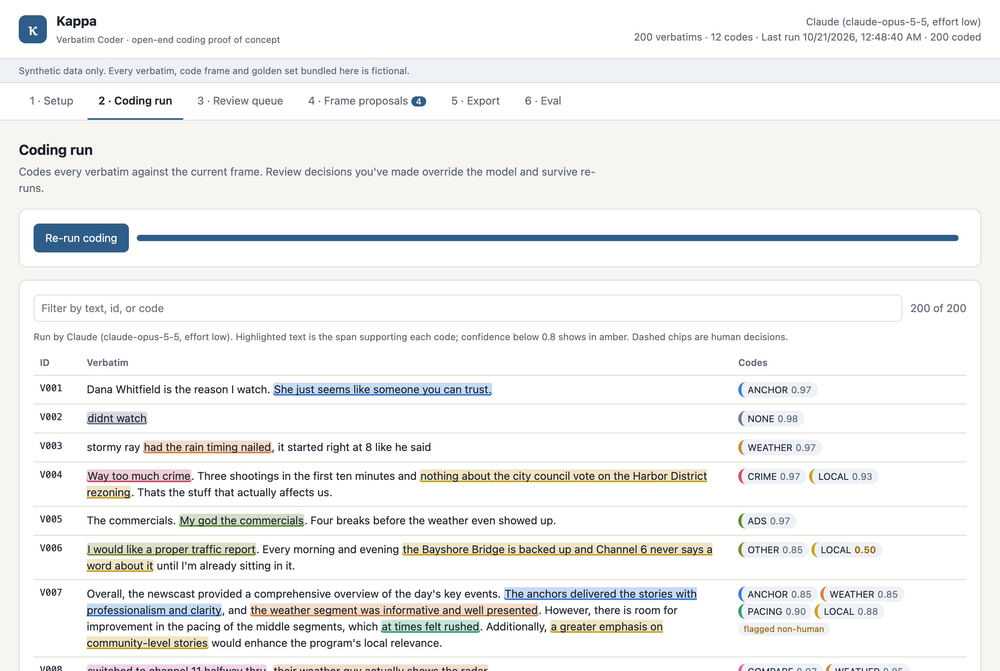
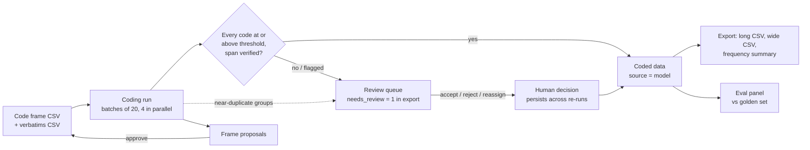
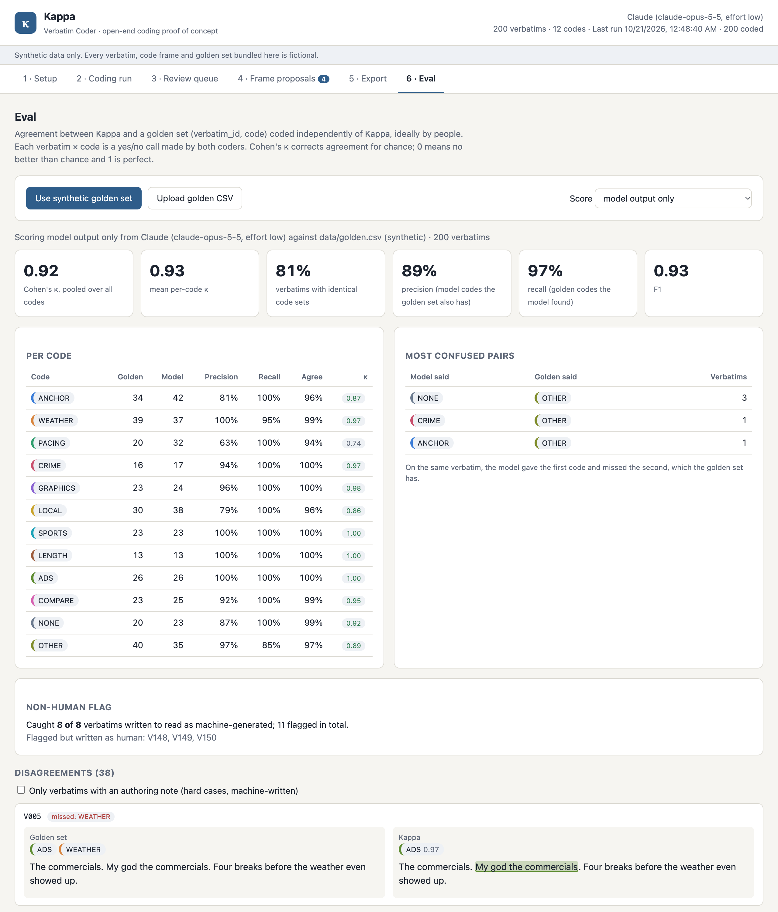
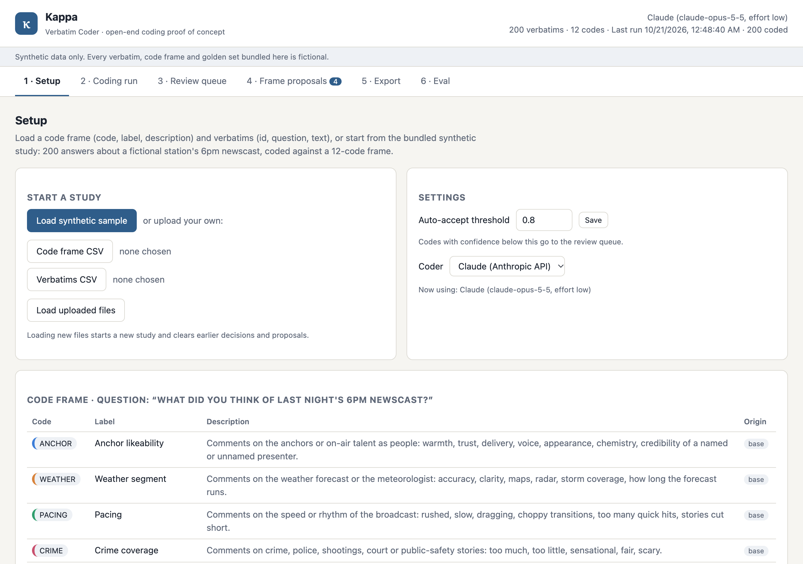
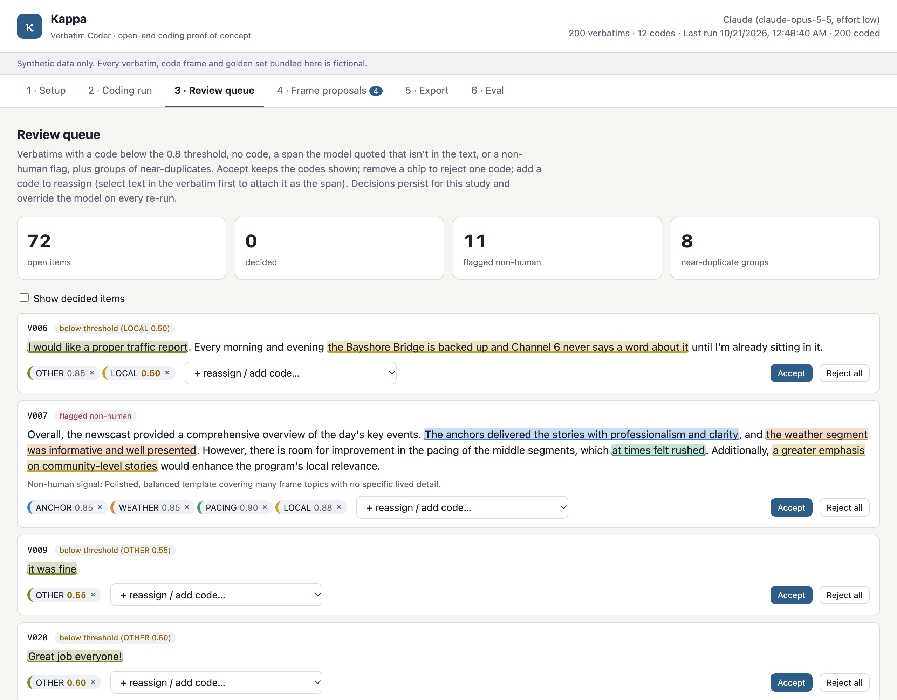
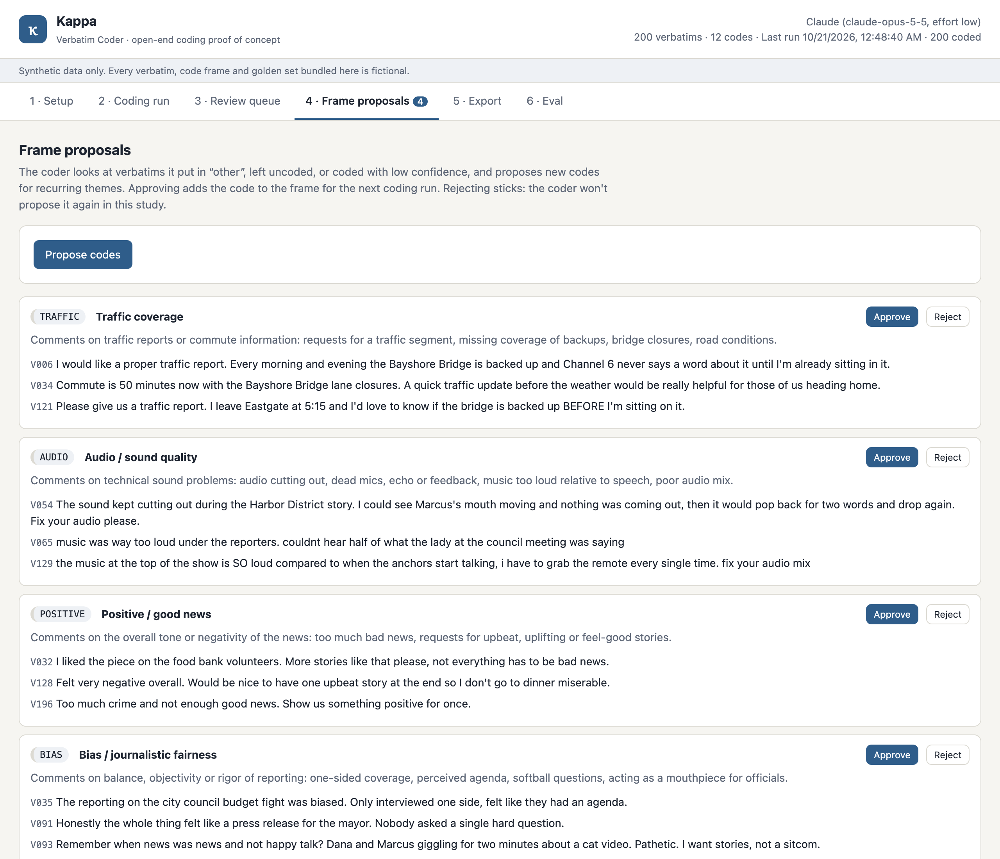
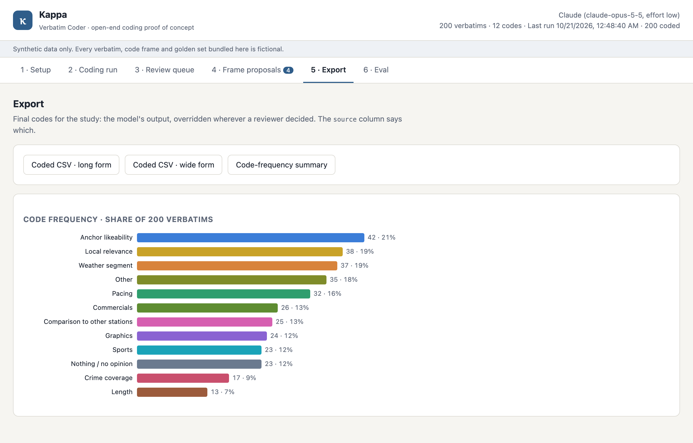

# Kappa

**AI-assisted open-end coding for survey research.** A model reads every open-ended survey answer, assigns codes from the study's code frame, quotes the words that justify each code, and sends anything it isn't sure of to a human coder. The human decides those. Kappa then measures itself: every run can be scored against a golden set, and it reports Cohen's kappa, the agreement statistic it is named after.

**Every record in this repository is synthetic.** The TV station (Channel 6 / KPCN in Port Calder), its competitors, its on-air staff, the 200 survey answers, the code frame and the golden set are fictional and were written for this project. There is no real survey data, no respondent information and nothing drawn from any real client study.

Built by Phil Rajewski as a working prototype of one AI use case for a quantitative research firm. The pattern: a high-volume judgment task that people already do by hand, a model that does the routine part and shows its evidence, a person who handles what the model can't, and an eval that says how far to trust the model.



## The problem

Most quantitative surveys end with a few open-ended questions: "Why did you give that score?", "What did you think of last night's newscast?", "What comes to mind when you think of this brand?" The answers, called verbatims, are often the most useful data in the study, because they say *why*. They can't be tabulated until someone codes them: reads each answer and assigns categories from a code frame (anchor likeability, weather, too many commercials, and so on). Only then can the answers be counted, cross-tabbed by audience segment, and compared from one wave of a tracking study to the next.

Coding is still largely done by hand. It is slow, because a study can have thousands of verbatims per question. It is inconsistent, because two coders, or one coder on Monday and Friday, will place borderline answers differently. And it sits on the critical path between fieldwork closing and the client getting a report. It is one of the oldest manual costs in survey research, and one of the easiest places to check an AI system against work people have already done.

What makes it hard is not the reading:

- **Answers carry several codes.** "Ray nailed the forecast but the ads ran forever" is both WEATHER and ADS.
- **Sarcasm.** "Oh great, another hour of car crashes, really helps me sleep" is a complaint about crime coverage.
- **Vague references.** "The guy kept messing up the scores" could be the anchor or the sports anchor.
- **The frame goes out of date.** Respondents raise themes the frame never anticipated.
- **Fake respondents.** A growing share of online survey answers are machine-generated, and an AI-written answer can pass every surface check.

A coder that is confidently wrong is worse than none, because nobody downstream can see the error once it becomes a percentage in a crosstab.

## What it does

Kappa codes every verbatim in a study in one pass: 200 answers in about 90 seconds. For each code it assigns, it returns:

- a **supporting span**, the exact words in the answer that justify the code, checked against the text before it's accepted
- a **confidence**, its estimate that a careful human coder would assign the same code
- a **non-human flag** with a reason, when the answer reads as machine-generated

Answers whose codes all clear the auto-accept threshold (0.8 by default) are done. Everything else goes to a **review queue** and is marked `needs_review` in the export until a person decides:

- codes below the threshold
- answers left uncoded
- spans that couldn't be verified
- answers flagged as non-human
- groups of near-duplicate answers

A coder accepts, rejects or reassigns each item. Their decision overrides the model and survives every later run.

When answers keep landing in "other", Kappa **proposes new codes** for the frame, each with three example answers. A person approves or rejects each proposal. Approved codes are used in the next run. Rejected ones stay rejected, and the model is told not to propose them again.

The **export** is the coded data in long form (one row per verbatim and code, with confidence, span, whether a model or a human decided, and whether it still needs review) and in wide form (one 0/1 column per code), plus a code-frequency summary with a bar chart.

The **eval panel** scores any run against a golden set and shows:

- overall and per-code agreement
- the code pairs the model confuses most
- every disagreement, with the golden set's answer and the model's answer and span side by side

## The agent, as a job description

The model inside Kappa is the **Verbatim Coder**. It is scoped the way you would scope a junior coder's job:

| | |
|---|---|
| **Scope** | Codes the open-ended answers in one study against that study's code frame. Proposes additions to the frame. Flags likely non-human answers and near-duplicates. Reports its agreement against a golden set when one is provided. |
| **Decides alone** | The codes for any answer that trips no review rule: every code clears the auto-accept threshold, every span checks out, and nothing is flagged. Those codes go into the export marked `source=model`, `needs_review=0`. It also decides which answers need review, and which recurring themes are worth proposing as codes. |
| **Recommends** | Every code below the threshold, every new code for the frame, and every non-human flag. Each recommendation comes with the quoted span or the example answers behind it. |
| **Never decides** | The final code for anything in the review queue. Whether a proposed code joins the frame. Whether a flagged answer is removed from the data (it flags; a person removes). It never overrides a human decision on a re-run. |
| **Reports to** | The research director or coding supervisor who owns the study. They set the threshold, work the review queue, own the frame, and read the eval panel before trusting a run. |

The threshold is how the line between "decides alone" and "recommends" gets moved. A cautious team starts it high, sending more to review, and lowers it as the eval panel earns trust.

## How it works



**Design choices that matter:**

- **Evidence or it doesn't count.** The model must quote the shortest exact substring that justifies each code. Kappa checks the quote against the answer, ignoring case. If the quote isn't there, the code is kept, its span is blanked and the answer goes to review. Coders see the evidence highlighted in the text, so checking a code takes a glance, not a re-read.
- **Constrained output.** The model answers through a JSON schema whose code field is an enum of the frame's codes, so it cannot invent a code or return malformed output. A code the model wants but the frame lacks has to come through the proposal path, where a person decides.
- **Humans win, permanently.** A review decision is stored as the final code set for that answer and overrides the model on every later run, even after the frame changes or the model is swapped.
- **The frame is a living document, under human control.** Proposals come only from what the model couldn't place: answers coded "other", left uncoded, or coded with low confidence. They become codes only on approval. Rejections are fed back into the next proposal request.
- **The eval is a screen, not a script.** Agreement against a golden set is one tab away from the results, so it gets read before the results are trusted.
- **The model is swappable.** One interface (`codeBatch`, `propose`) sits in front of two adapters: Claude through the Anthropic SDK, and an offline keyword baseline that needs no network or credentials. The baseline also gives the eval panel a floor to compare against.

## The evaluation

**The golden set.** It covers all 200 verbatims, with 307 codes, and was written before any coding run and never adjusted afterwards. It includes a dozen deliberate hard cases, documented in [`data/golden_sidecar.csv`](data/golden_sidecar.csv) with the intended coding and why each is hard:

- sarcasm whose literal reading is the opposite
- "the guy" with no clear referent
- answers that need several codes, one of them subtle
- answers on the border between two codes

The set also includes 8 answers written to read as machine-generated, 13 answers about two themes the frame deliberately doesn't cover (traffic reports and audio problems), and several near-duplicate groups.

**How the golden set was made, and why it matters.** The verbatims and their gold codes were written together, from a written codebook, by AI authoring agents (Claude) separate from the coding run. No gold code came from Kappa. But the author and the coder are the same model family, so they probably share interpretive habits. The numbers below show that the pipeline works and how well the model follows a codebook. They are not a forecast of agreement with human coders. The right production test is a golden set coded by two people, so their agreement with each other is the ceiling Kappa is measured against. The eval panel accepts any golden CSV for exactly that.

**Results.** These are three independent Claude runs on the 12-code frame plus the offline baseline, reported as measured with nothing tuned:

| Coder | Pooled κ | Mean per-code κ | Exact code set | Precision | Recall | Non-human flag |
|---|---|---|---|---|---|---|
| Claude (`claude-opus-5-5`, effort low), 3 runs | **0.92 – 0.935** | 0.93 – 0.94 | 81 – 84% | 89 – 91% | 97% | caught 8/8 every run; 0 to 3 false positives |
| Offline keyword baseline | 0.53 | 0.53 | 34% | 52% | 71% | 7/8, no false positives |

Each Claude run coded 200 verbatims in 90–98 seconds. Pooled κ counts each verbatim × code yes/no decision as a pair of judgments and corrects their agreement for chance.

**What the errors look like:**

- **Claude over-codes rather than misses.** Recall is 97%, but ANCHOR and PACING collect codes the codebook wouldn't give (precision 0.63 to 0.81). Raising the threshold for those codes, or tightening their descriptions, are the obvious levers.
- **Generic one-liners** ("it was fine") get NONE where the codebook says OTHER. This disagreement is about the codebook's convention, not about reading the answer.
- **Some false positives are copy-paste duplicates.** Every non-human false positive across the runs was a human-written near-duplicate (the same complaint pasted two or three times). The model seems to read copy-paste as bot-like. That is arguably a useful quality signal, but it isn't stable from run to run, which is why the flag routes the answer to a person instead of dropping it.
- **Frame proposals found the planted themes.** They proposed Traffic coverage and Audio / sound quality, each with three correct examples, plus two plausible themes nobody planted (bias, wanting more positive news).

Reproduce the table, without touching the app's saved study:

```bash
node scripts/eval-cli.js anthropic
```

```bash
node scripts/eval-cli.js lexical
```



## Who this is for

Kappa fits any organization that fields surveys with open-ended questions at volume, has a code frame (or wants one), and has to defend the resulting numbers to someone else. In rough order of fit:

| Organization | Why open-end coding hurts there | What Kappa changes |
|---|---|---|
| **Custom quantitative research firms**, especially media and entertainment research for broadcasters, networks and streamers | Hundreds of studies a year, each with its own frame. Tight turnaround from field close to client report. Coding is margin. | Studies are coded in minutes. Coders work only the review queue. The eval panel gives the research director a number to stand behind. |
| **Brand and advertising tracking** | The same open-ends ("what brands come to mind", "what do you remember about the ad") every wave, compared over years | One frame applied consistently across waves, and drift checked against a golden wave instead of discovered in a client meeting |
| **Customer experience and voice-of-customer programs** | NPS and CSAT "why" comments arrive continuously, by the thousand | Continuous coding, with new themes surfacing as proposals instead of hiding in "other" |
| **Public opinion and political polling** | "Most important problem" questions with overnight deadlines | Same-night coding, with the review queue sized to the coders available |
| **Data-processing and coding bureaus** that code verbatims for other firms | Coding is the product, priced per verbatim | The bureau's coders become reviewers. Throughput rises and the eval panel documents quality for the client. |
| **Online panel and sample providers** | AI-generated open-ends are now a data-quality problem | The non-human flag and duplicate detection give a first screen, with a person making the removal call |
| **In-house insights, UX research, and employee-survey teams** | Small teams with big comment files and no dedicated coders | Coding becomes a task an analyst can supervise rather than a project to outsource |

**It is not a fit for** a 20-interview qualitative study, where reading every answer *is* the analysis. It isn't for answers too short to code. It also isn't for any setting where real respondent data can't be sent to a model provider under the organization's data-handling rules: this prototype calls a hosted model and has no redaction step.

## Screenshots

| | |
|---|---|
|  |  |
| **Setup.** Load a code frame and verbatims, set the auto-accept threshold, and choose the coder. | **Review queue.** Each item shows why it's there, and the coder can accept, remove a code, or reassign. |
|  |  |
| **Frame proposals.** The planted traffic and audio themes, found from the answers the model put in "other". | **Export.** Long and wide CSVs, the frequency summary, and the one chart. |

## Running it

```bash
npm start
```

Then open http://localhost:4317. You need Node 20 or later; `npm start` installs the one dependency (the Anthropic SDK) on first run.

The Claude coder finds credentials the SDK's usual way: `ANTHROPIC_API_KEY`, `ANTHROPIC_AUTH_TOKEN`, or an `ant auth login` profile. Without credentials, choose **Offline lexical baseline** on the Setup screen, or start with `KAPPA_ADAPTER=lexical npm start`.

To try the full workflow:
1. Click **Load synthetic sample**, then **Run coding**.
2. Work a few items in the **Review queue**.
3. Click **Propose codes**, approve one, and run coding again.
4. On **Eval**, click **Use synthetic golden set**.

| Variable | Default | Meaning |
|---|---|---|
| `KAPPA_ADAPTER` | `anthropic` | `anthropic` (Claude) or `lexical` (offline keyword baseline) |
| `KAPPA_MODEL` | `claude-opus-5-5` | Claude model for the anthropic adapter |
| `KAPPA_EFFORT` | `low` | Claude effort level |
| `PORT` | `4317` | Port for the local server |

Input formats: the code frame is `code,label,description`, verbatims are `id,question,text`, and the golden set is `verbatim_id,code` (one row per code, so a verbatim with several codes has several rows).

## Reference

### Synthetic data (`data/`)

| File | Contents |
|---|---|
| `code_frame.csv` | The 12-code frame: anchor likeability, weather, pacing, crime coverage, graphics, local relevance, sports, length, commercials, comparison to other stations, nothing/no opinion, other |
| `verbatims.csv` | 200 answers to "What did you think of last night's 6pm newscast?", from 1 to 97 words, varied in tone and literacy (typos, text-speak, run-ons, formal older-viewer prose) |
| `golden.csv` | The golden set: 307 codes for the 200 verbatims |
| `golden_sidecar.csv` | The 12 hard cases with their intended coding, and the 8 machine-written verbatims |
| `parts/*.json` | The authoring source; `npm run build-data` rebuilds the CSVs from it |

One known quirk: because the data was authored in four parallel batches, three answers (V051, V101, V151) open with the same sentence. The duplicate detector catches them, and they were left in as found.

### Repo layout

```
server.js                 local HTTP server and JSON API
lib/study.js              study state, coding run, review queue, proposals (persisted to study/state.json)
lib/adapters/anthropic.js Claude: structured output, cached system prompt, server-side refusal fallback
lib/adapters/lexical.js   offline keyword baseline
lib/eval.js               Cohen's kappa, precision/recall, confusions, disagreements
lib/dupes.js              near-duplicate groups (character-shingle Jaccard)
lib/export.js             long/wide CSV and frequency summary
public/                   the six-screen UI, no framework
scripts/eval-cli.js       headless run + score, for reproducing the results table
scripts/build-data.js     rebuilds data/*.csv from data/parts/
```

### What changes for production

- **A human golden set.** Two coders code a sample of real, permitted data independently. Their agreement with each other sets the ceiling, and Kappa is measured against it before any threshold is set.
- **Confidence calibration.** The threshold assumes confidence means something. Measure it on the golden set (reliability by bucket) before letting it route work.
- **Data handling.** Redact respondent PII before any model call, and use a provider configuration that meets the organization's retention requirements.
- **An audit trail.** Record who decided each reviewed item, when, and under which frame version. Version the frame across waves.
- **Scale and cost.** Use the batch API for large studies, track cost per study, and support multiple studies and users with auth.
- **Multi-language.** Many trackers field in several languages, so the frame and spans would need to work across them.

## License

MIT. See [LICENSE](LICENSE).
